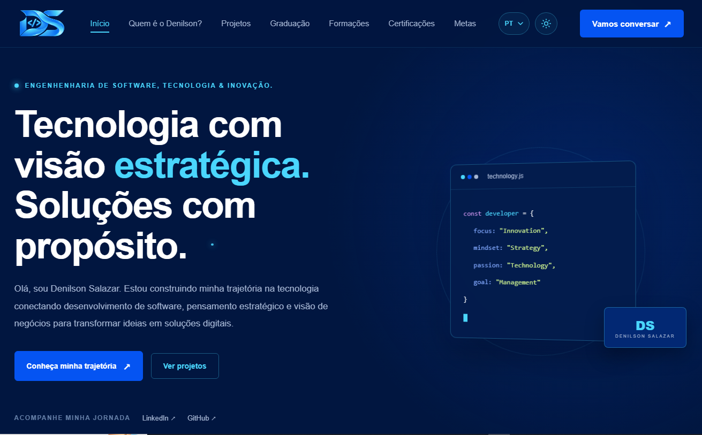
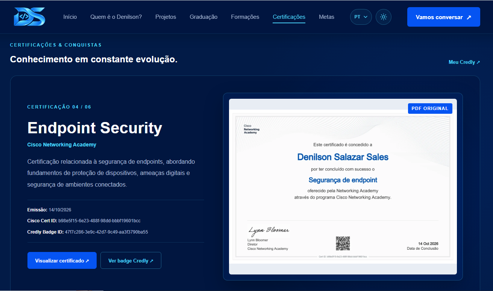

# 🚀 Denilson Salazar | Portfólio Profissional

<p align="center">
  <a href="https://denilsonsalazar-br.github.io/Landing-Page/">
    
  </a>
</p>

<p align="center">
  <strong>Conhecimento, desenvolvimento e evolução profissional.</strong><br>
  Portfólio pessoal desenvolvido para apresentar minha trajetória, qualificações, conhecimentos técnicos e projetos na área de tecnologia.
</p>

---

## 🌐 Sobre o projeto

Este projeto é meu portfólio profissional pessoal, desenvolvido com o objetivo de construir minha presença digital e apresentar minha trajetória ao mercado de trabalho, especialmente para oportunidades de estágio e emprego na área de tecnologia.

A plataforma reúne informações sobre minha formação acadêmica, qualificações técnicas, certificações, conhecimentos, projetos desenvolvidos e objetivos profissionais, permitindo que recrutadores, empresas e profissionais da área conheçam melhor meu perfil.

Mais do que uma apresentação pessoal, este portfólio representa meu compromisso com o aprendizado contínuo, o desenvolvimento de habilidades e a construção de uma carreira na área de tecnologia da informação e desenvolvimento de software.

## 📸 Prévia do projeto

Confira algumas das principais seções do meu portfólio profissional:

<table align="center">
  <tr>
    <td align="center" width="50%">
      
      <br>
      <strong>01. Página inicial</strong>
      <br>
      <sub>Apresentação pessoal e identidade profissional.</sub>
    </td>
    <td align="center" width="50%">
      
      <br>
      <strong>02. Certificações</strong>
      <br>
      <sub>Formações complementares e conquistas profissionais.</sub>
    </td>
  </tr>
  <tr>
    <td align="center" width="50%">
        
        <br>
        <strong>03. Projetos</strong>
        <br>
        <sub>Projetos pessoais e acadêmicos desenvolvidos.</sub>
        </td>
    <td align="center" width="50%">
        
        <br>
        <strong>04. Metas</strong>
        <br>
        <sub>Planejamento e objetivos de desenvolvimento profissional.</sub>
    </td>
  </tr>
</table>

## 🎯 Objetivos

- Apresentar meu perfil acadêmico e profissional.
- Demonstrar meus conhecimentos técnicos e habilidades em desenvolvimento.
- Reunir projetos pessoais e acadêmicos em um único ambiente.
- Disponibilizar minhas formações e certificações profissionais.
- Facilitar o contato com recrutadores e empresas.
- Ampliar minhas oportunidades de estágio e inserção no mercado de tecnologia.

## ✨ Funcionalidades

- **Apresentação profissional:** informações sobre minha trajetória, perfil e objetivos de carreira.
- **Projetos:** exposição de aplicações e soluções digitais desenvolvidas.
- **Formação acadêmica:** apresentação da graduação em Engenharia de Software.
- **Formações técnicas:** detalhamento das qualificações em Informática e Administração.
- **Certificações:** apresentação de cursos e credenciais, com links para validação.
- **Planejamento e metas:** apresentação dos meus objetivos acadêmicos e profissionais.
- **Alternância de tema:** opção de visualização nos temas claro e escuro.
- **Suporte multilíngue:** navegação em português e inglês.
- **Elementos interativos:** animações e recursos visuais para aprimorar a experiência de navegação.
- **Links profissionais:** acesso aos meus perfis no GitHub, LinkedIn e Credly.

## 🛠️ Tecnologias utilizadas

| Tecnologia | Aplicação |
|---|---|
| HTML5 | Estruturação semântica do conteúdo |
| CSS3 | Estilização, identidade visual e responsividade |
| JavaScript | Interatividade e funcionalidades dinâmicas |
| Git | Controle de versão |
| GitHub | Gerenciamento e versionamento do código |
| GitHub Pages | Hospedagem e publicação do portfólio |

## 📂 Estrutura do projeto

```text
Landing-Page/
│
├── anotações/          # Anotações e materiais de apoio
├── certificados/       # Certificados e documentos
├── css/                # Arquivos de estilização
├── img/                # Imagens e recursos visuais
│   └── screenshots/    # Capturas de tela do portfólio
│       ├── inicio.png
│       ├── certificacoes.png
│       ├── projetos.png
│       └── metas.png
├── js/                 # Scripts e funcionalidades
│
├── index.html          # Página principal
├── LICENSE             # Licença do projeto
└── README.md           # Documentação
```

## 💻 Como executar localmente

Para visualizar ou modificar o projeto em seu computador:

1. Clone o repositório:

```bash
git clone https://github.com/Denilsonsalazar-br/Landing-Page.git
```

2. Acesse a pasta:

```bash
cd Landing-Page
```

3. Abra o arquivo `index.html` em seu navegador.

Não é necessário instalar dependências para executar a versão estática do projeto.

## 🌍 Acesso ao portfólio

O projeto está publicado por meio do **GitHub Pages** e pode ser acessado pelo link:

🔗 [**Acessar portfólio online**](https://denilsonsalazar-br.github.io/Landing-Page/)

## 👨‍💻 Sobre mim

Sou estudante de Engenharia de Software, com formação técnica em Informática e Administração. Tenho interesse em desenvolvimento de software, desenvolvimento web, banco de dados e arquitetura de sistemas.

Estou em constante aprendizado, buscando aprimorar meus conhecimentos por meio da graduação, cursos, certificações e desenvolvimento de projetos práticos.

Atualmente, busco uma oportunidade de estágio ou trabalho na área de tecnologia, na qual possa aplicar meus conhecimentos, adquirir experiência profissional, contribuir com soluções e continuar evoluindo como profissional.

### Conecte-se comigo

<p align="center">
  <a href="https://github.com/Denilsonsalazar-br">
    
  </a>
  <a href="https://www.linkedin.com/in/denilson-salazar-sales/">
    
  </a>
  <a href="https://www.credly.com/users/denilson-salazar">
    
  </a>
</p>

---

<p align="center">
  Desenvolvido por <strong>Denilson Salazar</strong> · 2026
  <br>
  <em>Construindo conhecimento, desenvolvendo soluções e evoluindo profissionalmente.</em>
</p>